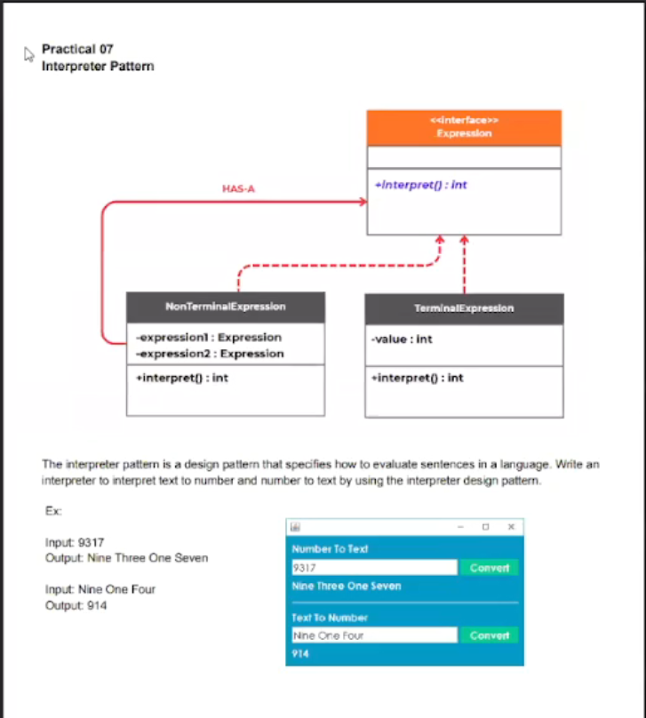

# Number and Text Converter

A Java Swing desktop application that demonstrates the **Interpreter design pattern** by converting individual digits between numeric and English word representations.

This project was created for Practical 07 of the Interpreter Pattern exercise.

## Features

- Convert a number into digit-by-digit English words.
- Convert English digit words into a number.
- Demonstrate the `Expression`, `TerminalExpression`, and `NonTerminalExpression` components of the Interpreter pattern.
- Simple graphical user interface built with Java Swing.

## Examples

### Number to text

```text
Input: 9317
Output: Nine Three One Seven
```

### Text to number

```text
Input: Nine One Four
Output: 914
```

The converter works with the digits `0` through `9`. It interprets each digit separately rather than converting a whole number into a spoken number such as "nine thousand three hundred seventeen".

## Technologies

- Java 17
- Java Swing
- Apache Maven
- NetBeans

## Requirements

- JDK 17 or newer
- Apache Maven 3.8+ (optional when using NetBeans)

Check the installed versions with:

```bash
java -version
mvn -version
```

## Getting started

Clone the repository and move into the project directory:

```bash
git clone https://github.com/Sahan-Kaushalya/Interpreter-design-pattern-Practical.git
cd Interpreter-design-pattern-Practical
```

## Running the application

### From NetBeans

1. Open the project in NetBeans.
2. Right-click the project.
3. Select **Run**.

### With Maven

Compile the project and create the JAR:

```bash
mvn clean package
```

Then run the application from your IDE or NetBeans using the `com.kaushalya.converter.Convertor` main class.

## How to use

1. Enter a numeric value in the **Number To Text Convert** field.
2. Select **Convert** to display each digit as an English word.
3. Enter digit words separated by spaces in the **Text To Number Convert** field.
4. Select **Convert** to display the corresponding numeric digits.

## Interpreter pattern implementation

The application models the conversion expressions as follows:

```text
Expression
├── TerminalExpression
└── NonTerminalExpression
```

- `Expression` defines the `interpret()` operation.
- `TerminalExpression` represents a single digit and returns its value.
- `NonTerminalExpression` combines two expressions by interpreting both and adding their results.
- `Convertor` creates and evaluates terminal expressions while handling the Swing user interface.

## Project structure

```text
.
├── pom.xml
├── LICENSE.txt
└── src
    └── main
        └── java
            └── com
                └── kaushalya
                    └── converter
                        ├── Convertor.form
                        ├── Convertor.java
                        ├── Expression.java
                        └── practical.png
```

## Screenshot



## License

This project is available under the [MIT License](LICENSE.txt).
